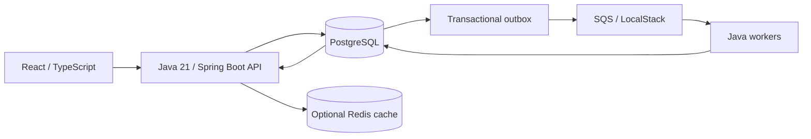

# PokerLab Cloud

The [twenty-decision sizing trainer](docs/twenty-question-sizing-trainer.md) adds two pot-size BB responses through a separately pinned, default-off v7 collection and table UI; existing eighteen-question reviews remain compatible with v6.

The [BB sizing screen and pot-size drill](docs/bb-sizing-primary-screen.md) checks quarter-pot and pot-size models before fresh qualification. Pot-size bets yield two qualified backend responses: call with BB99 and fold with AcJc. Cached public questions, grades and a four-attempt review retain the actual 6.5bb call price; quarter-pot failures and every other context remain visible.

The [BB pairwise-regret survey](docs/big-blind-pairwise-regret.md) tightens conditional loss bounds without changing source EVs, then checks every context against two fresh 80k/160k policies. Two call/fold candidates gain action separation but fail actual reach; all six outcomes remain visible and no rejected question can be graded.

The [big-blind flop study](docs/big-blind-flop-discovery.md) covers all three supplied BB hands, first to act and responding to a BTN bet. A separately versioned phase-I simplex mode certifies all six contexts after preserving the original six numerical failures. Independent checks reconstruct the physical game and verify 51 endpoint certificates. Ambiguous results remain research-only.

The [eighteen-decision table](docs/eighteen-question-table.md) connects the v6 collection to a separate practice page with six-seat tables, EV/loss feedback, saved reviews and an optional study inspection that reveals action EVs without counting an attempt. The new mode loads on demand; older practice routes remain available.

The [eighteen-question backend trainer](docs/unpaired-flop-collection.md) combines the existing fourteen decisions with all four qualified hands on 6♦ T♦ Q♣. Its separate default-off v6 API physically replays seven sources once, then serves cached questions, EV/loss grades and exact reviews. Older trainer routes and source pins remain unchanged.

The [unpaired physical-flop source](docs/unpaired-flop-source.md) adds four qualified backend fold/call decisions on 6♦ T♦ Q♣, with independent physical/LP checks, two fresh reference policies and an exact eight-attempt review. Four after-check cases remain explicitly rejected with certified zero-reach witnesses. A new CLI generates the report and review from one owned solve; website collections remain separately pinned.

The [certified negative-reach mode](docs/certified-negative-reach.md) now explains four previously numerical after-check failures with original-LP witnesses of zero reach. It preserves the four positive interval results and the existing trainer, with separately versioned replay and independent physical/security checks.

The [weak-range coverage study](docs/weak-range-flop-coverage.md) now surveys all four BTN holdings after check and facing bet, retaining four complete interval solutions and four explicit numerical rejections. It adds ordered offline discovery and inspection; fresh-reference qualification remains required before new trainer content.

The [cached CFR reference traversal](docs/cached-cfr-traversal.md) reduces repeated tree-walking overhead while preserving each producer's pruning mode, policies, published work counts and qualification gates. A bounded diagnostic main checks exact policy/work equality before reporting traversal timings.

The original single-question BTN producer now uses that cache too, with its original `NONE` pruning and fresh solver per reference. A complete 80k/160k comparison reproduces its original report exactly.

The [eleven-question flop collection](docs/qualified-flop-collection.md) combines the original ten contexts with the qualified weak-hand folding scenario through a separately versioned API, replayable review and table UI.

The [qualified weak-hand backend trainer](docs/qualified-weak-hand-flop-trainer.md) adds a separately pinned BTN 2c3c fold/call decision, fresh reference qualification, cached grading/review and a default-off API. The existing ten-question website collection retains its original sources.

The [explicit resolvable/refined endpoint mode](docs/resolvable-refined-endpoints.md) now solves a new weak-hand fold decision with independently regenerated physical counts and 298 exact-fraction LP controls. It remains a research result pending fresh trainer qualification.

A distributed Texas Hold’em simulation platform: submit exact hands, split millions of Monte Carlo trials into reproducible batches, process them with independent workers, and inspect equity and progress in a React workspace.

Built around an existing Java poker engine, with PostgreSQL as the durable source of truth and explicit protection against duplicate queue delivery.

## Architecture



## Features

The [initial physical-flop interval drill](docs/supplied-flop-feedback.md) now qualifies one BB77 question from PokerLab's owned connected solver, checks fresh policies against the complete security face, and serves cached six-seat questions, EV/loss-range grades and exact reviews through a separate opt-in API. Its `#interval-flop` table UI shows the board, all seats, action ranges and immediate feedback, with replayable review downloads. Ambiguous questions remain rejected; the local Compose overlay performs pinned physical replay at startup.

The [later BB flop trainer](docs/supplied-flop-feedback.md#later-bb-table-ui) now serves a separate pinned fold/call question after BB checks and BTN bets. It performs complete physical replay once at startup, then caches interval grades and exact reviews. An independent checker verifies the report and every saved attempt. Its `#interval-flop-response` table shows the completed bet, amount to call, both action ranges and immediate feedback. The initial check/bet protocol remains separate.

The [combined flop practice collection](docs/flop-interval-collection.md) now presents both independently qualified contexts in one pinned session. It preserves the initial check/bet and later fold/call protocols, remembers each question's feedback, counts distinct contexts separately from retries, and exports an exact mixed review. Both sources physically replay once at startup; the browser and HTTP requests use cached evidence. These two decisions from the same supplied hand do not establish broader range coverage or a full-hand strategy.

- 2–9 players with exact hole cards, 0–5 known community cards and up to 100 million trials.
- Seeded batches, correct multiway tie splitting, per-player wins/ties/losses/equity.
- Durable submission/outbox, retry, visibility renewal, dead-letter handling and idempotent finalisation.
- PostgreSQL migrations and real concurrency tests; optional Redis cache with outage fallback.
- Scenario form, progress polling, results and recent simulations.
- OpenAPI, structured logs, Actuator metrics, Docker Compose, AWS Terraform and GitHub Actions.

The separate `solver` Maven module implements PokerLab's own CFR/CFR+ solvers, exact finite-game best responses, weighted physical-card ranges and saved-pack EV grading. Local **validation-only** drills include an all-in demo, bounded street decisions and a full-round six-seat preflop table. The backend also connects every seat's preflop decisions to selected heads-up flop/turn/river betting continuations; [physical-flop width studies](docs/sixmax-flop-width-study.md) measure coverage and cost, while [continuation feedback](docs/sixmax-continuation-preflop-feedback.md) re-solves preflop against improved postflop values and checks the changed ranges. [Quality-gated alternating rounds](docs/sixmax-alternating-continuation-rounds.md) retain only candidates that meet conditional accuracy and materially improve the full-game score, with resumable source-bound policy checkpoints. [Eight-deal private coverage](docs/sixmax-eight-deal-private-coverage.md) adds folded-seat uncertainty and separate prior/reached range diagnostics. [Active-pair selection](docs/sixmax-diverse-active-pair-selection.md) can require material source hand mixes and choose different players while preserving full private support. [Correlated private ranges](docs/sixmax-correlated-private-ranges.md) retain twelve physical worlds across four uncertain seats, with offline pairwise and full-joint dependence audits that keep concealed ranges outside trainer questions. A [retained coverage screen and bounded menu search](docs/sixmax-retained-continuation-coverage.md) separate final-policy content usefulness from strategy quality; the earlier twelve-world trials improve their scores but fail retained reach and hand-diversity criteria. A [fresh betting-model study](docs/sixmax-preflop-payoff-reuse.md) reuses exact showdown shares while recomputing all betting utilities and strategies; both fresh open-only connected trials retain a useful BB/CO history and pass the same quality/content checks. A [same-game policy comparison](docs/sixmax-connected-policy-stability.md) measures independent-seed action-frequency disagreement without diluting rare postflop decisions. [History-dependent raises and range sensitivity](docs/sixmax-staged-raise-schedules.md) add explicit 3bb-open/9bb-re-raise rules, backwards-compatible versioned packs and matched-budget diagnostics; three fresh sources still fail the unchanged useful-content screen. An [all-flop material feasibility bound](docs/sixmax-material-continuation-feasibility.md) now rules out inadequate frozen-source hand coverage before more seed searches or connected solves; the open-only control remains not ruled out. The opt-in [research API](docs/local-development.md#research-trainer-api) is disabled by default. These synthetic, restricted games are not general cash-poker charts; see the [GTO trainer plan](docs/GTO_Trainer_Plan.md) for remaining scope and validation gates.

The [rank-aware six-seat continuation study](docs/sixmax-rank-texture-continuation.md) jointly trains preflop and a bounded heads-up flop bet round across 1,182 public rank/texture signals. Exact conditional payoffs, complete saved policies and independent physical-board audits measure both own-model quality and remaining suit information error. [Fixed-utility pruning](docs/sixmax-pruning-and-board-witnesses.md) reduces redundant folded-player traversal. These offline experiments remain validation-only and do not qualify as general poker lessons.

The [reached-decision audit](docs/sixmax-rank-texture-conditional-audit.md) checks every selected history/signal case and verifies local unilateral gains through direct full-game policy evaluation. Saved replay and independent pure-plan enumeration expose rare-decision gaps that the aggregate solver score can conceal.

The [bounded suit-refinement model](docs/sixmax-suit-refinement.md) now reveals actual flop cards in fifteen declared groups, trains fresh complete policies and replays 7,806 conditional cases. Every refined pair payoff is independently enumerated, while physical-board witnesses confirm that the declared groups preserve actual suits and folded blockers. Large rare-decision gaps remain, so these policies stay offline validation evidence.

[Targeted conditional refinement](docs/sixmax-suit-conditional-refinement.md) now freezes preflop ranges and re-solves weak spots with explicit fresh budgets. A balanced 64-case derivative reduces the worst local gap from 6.60 to 1.28bb and improves the full-game gap by about 5.7%, while replay checks all 7,806 cases, unchanged strategy rows and predecessor lineage. It remains validation evidence; wider physical-board coverage and a retained trainer quality screen are still required.

[Physical-hand decision stability](docs/sixmax-suit-decision-stability.md) now calculates own-card action EVs with optimal hero continuation, checks fresh 500/1000-budget references and detects changes in the private-hand posterior after public actions. The first screen retains 23 of 32 physical board/history cases; 127 of 148 material decisions pass. Saved evidence replays every solve and EV, but limited physical coverage still prevents trainer admission.

[History-specific physical flop observations](docs/sixmax-history-physical-observations.md) expand the backend's fixed board menu within the existing compute caps. Public-history/card whitelists split exact physical payoffs from rank aggregates, preserve folded blockers and bind a separate model identity. The first menu reveals 530 flops in 915,457 states; fresh policies, complete parent/conditional reports and independent board/EV controls separate increased reached coverage from trainer-quality decisions. Selection currently concentrates on BB versus a CO open, and all evidence remains validation-only.

[History-specific conditional refinement and decision stability](docs/sixmax-history-physical-refinement.md) now freeze that model's preflop policy, re-solve selected physical posteriors and preserve every other strategy row. The broader 64-case candidate correctly fails its local gate and exports no policy. A separately declared accurate-case derivative passes complete parent checks, and fresh 500/1,000-budget references retain 28 of 32 screened cases with 143 of 151 material decisions passing. That bounded sample covers only 0.132% of all heads-up reach; it remains research evidence with trainer admission disabled.

[The owned bounded maxmin solver](docs/sixmax-owned-maxmin.md) now preserves that accepted CFR derivative and repairs its twenty remaining weak physical-board games. All 530 reached physical roots meet the local gate, full-parent NashConv improves to 0.00136881bb, and independent decision screening preserves the 28-case retained sample. Complete matrix/behavioral-policy replay and 120 independent mathematical controls validate the solver; it adds no production LP dependency or trainer admission.

[The owned sequence-form solver](docs/sixmax-owned-sequence-form.md) now removes complete-plan enumeration for bounded two-player games. A 32-private-type control uses 65 sequences per actor instead of 2^32 plans, with both owned LPs and independent behavioral best responses. A separately bound physical-board derivative preserves the same twenty repairs, complete parent checks and 28-case retained screen. Its signed-RHS LP, original-basis LU, work limits and 292 independent oracle problems plus 876 reordered/scaled controls add no production dependency or trainer admission.

[The affine sequence-form path](docs/sixmax-affine-sequence-form.md) now removes dependent flow variables while preserving the original solver and saved replay. It solves 54 synthetic one-bet controls up to 32 private types and 15 fixed-raise controls within unchanged limits, backed by exact integer projections and independent full-game best responses. A separate physical derivative preserves the same twenty repairs and retained action-EV screen with substantially less charged LP work on that saved instance. Broader poker coverage and trainer admission remain separate work.

[The actual-card conditional preflop study](docs/sixmax-actual-preflop-conditional-study.md) now solves CO versus BB under fixed full-joint source beliefs, preserves folded-card blockers, and checks every material action EV against fresh independent references. The 3/9bb and 3/9/22bb ladders supply a deterministic offline trainer with public six-seat tables and ten-question reviews. The larger five-target ladder fails feedback stability and exports diagnostics only. Mandatory checkdown, synthetic ranges and no rake remain explicit research limits.

A third [offline conditional trainer scenario](docs/sixmax-actual-preflop-conditional-study.md) now covers BB facing a CO limp–re-raise, with folded callers' chips represented in the six-seat table. All four material decisions pass independent feedback screening.

[Supplied joint-range preflop research](docs/sixmax-supplied-joint-preflop.md) now supports larger explicitly declared conditional hand sets without traversing the full six-seat source tree. Two 18-world examples and a deeper 27-world 3/9/22bb example cover BTN/BB defense and CO facing a BTN 3-bet, preserve all folded blockers, pass all 17 material feedback checks and supply offline ten-question drills. Supplied beliefs and unavailable source-history reach remain explicit; a separate unstable example exports diagnostics only.

[Root-action EV intervals](docs/sixmax-root-action-ev-intervals.md) now distinguish whole-game accuracy from ambiguity in alternative moves. The owned solver bounds every root move across an explicitly approximate opponent security face, checks original flows and independent hidden-information continuations, and reports conservative decision-loss ranges. A 27-world five-target A♣J♣ example identifies calling as robustly best while the raise EV spans about 0.196–0.729bb. Strict physical/numerical replay and an optional independent full-plan oracle preserve the diagnostic-only boundary; existing trainer gates remain unchanged.

[Later-decision EV intervals](docs/sixmax-conditional-action-ev-intervals.md) now account for opponent actions changing hidden-hand probabilities. The owned solver certifies positive reach over the complete security face before a bounded linear-fractional reduction, independently checks every posterior and reports all legal moves. In the 27-world BB99 re-raise example, calling has a tiny conservative loss bound while raising to 50bb spans about 8.629–9.112bb. Exact physical replay and a separate full-plan oracle agree; this remains diagnostic-only and leaves trainer admission unchanged.

The [explicit behavioral-floor solver](docs/sixmax-behavior-floor-solver.md) adds a separately identified owned LP solve, independent floor-aware CFR+ and replayable diagnostics for richer actual-card preflop menus. Original-game quality and all-action feedback remain separate gates; the five-target menu is still blocked from training.

[Joint conditional decision-loss bounds](docs/sixmax-joint-conditional-decision-loss.md) now compare legal moves against the same opponent strategy and hidden-hand posterior. Owned LPs optimize complete continuations, retain replayable endpoint witnesses and narrow the BB99 call-loss bound by about 62.5% versus subtracting separate EV intervals. An independent 729-by-5,832 normal-form oracle checks every joint control. This remains diagnostic-only; richer feedback needs its own reference-inclusion and admission checks.

[Selected-question interval feedback](docs/sixmax-interval-feedback-qualification.md) now qualifies the BB99 decision under an explicitly wider security face: call stays within a 0.01bb loss limit, fold is outside it, and raise-to-50 remains strategy-dependent. A separately identified conditioned solve preserves original certificates and all work limits. Fresh references must lie inside the face before their EV/loss ranges are checked; physical replay and an independent full-plan oracle agree. The [interval drill](docs/sixmax-interval-trainer.md) adds the actual six-seat question, cached range-based grades, saved-attempt replay and a default-disabled HTTP API with pinned physical qualification at startup. The old scalar study remains rejected, and public trainer admission stays off. Its separate `#interval-preflop` table UI now shows all move EV/loss ranges after a choice, three-way feedback, bounded retries and canonical review downloads for offline replay.

The literal-board model also has a proved capacity limit: its 600 history/board revelations can cover at most 6.073% of heads-up flops before quality filtering. Coverage requests above that limit fail before input loading or enumeration. The [compact 530-board storage prototype](docs/sixmax-compact-physical-storage.md) now exactly restores all counts/payouts and reproduces full parent/conditional diagnostics and twenty local maxmin/CFR+ controls with primitive lookup arrays. The [broader physical-capacity design](docs/sixmax-broader-physical-capacity-design.md) keeps the unchanged 25% retained-content target and requires a separately identified broader model with measured state, memory and evidence budgets. Compact storage leaves legal states and coverage unchanged.

The [four-question interval collection](docs/sixmax-l1-interval-collection.md) adds qualified BB decisions with 77, 99 and suited AJ. An explicitly selected L1 row representation certifies the original LP constraints and preserves old reports and work caps. The ordered collection binds every source, physically replays all four reports at startup, and supports cached navigation, grading and canonical reviews through a separate default-disabled API. Independent full-plan checks cover 83 fresh LPs and 72 joint witnesses. Browser collection navigation is the next frontend step; general trainer admission remains off.

Java 21 · Maven · Spring Boot 4.1 · PostgreSQL 16 · SQS · Redis 7 · React 19 · TypeScript · Vite · Terraform · ECS Fargate

## Quick start

Requires Docker with Linux containers and Compose v2. The stack includes application images and two workers; no separate Java/Node installation is needed.

```sh
git clone https://github.com/pingadom/PokerSolver.git
cd PokerSolver
cp .env.example .env
docker compose up --build -d --scale worker=2
```

On PowerShell, replace the copy command with `Copy-Item .env.example .env`.

Open **[PokerLab at localhost:8080](http://localhost:8080)**. Submit the default AA vs KK vs QQ scenario. View [Swagger](http://localhost:18080/swagger-ui/index.html) or [health](http://localhost:18080/actuator/health).

Run `./scripts/smoke.ps1` on Windows, or `./scripts/smoke.sh` with curl/jq on Linux. Stop with `docker compose down`; the database volume is preserved. [Local development](docs/local-development.md) covers IDE runs and a durable PostgreSQL queue alternative when Docker is unavailable.

## API example

```sh
curl http://localhost:18080/api/v1/simulations \
  -H 'Content-Type: application/json' \
  -d '{"players":[{"name":"AA","cards":["AS","AH"]},{"name":"KK","cards":["KS","KH"]},{"name":"QQ","cards":["QS","QH"]}],"board":[],"iterations":10000000,"batchSize":100000,"seed":123456789}'
```

The API returns **202 Accepted**, a `Location` header and:

```json
{
  "simulationId": "<generated UUID>",
  "status": "QUEUED",
  "statusUrl": "/api/v1/simulations/<generated UUID>"
}
```

Poll the status URL for `completedIterations / requestedIterations`. Fetch `{statusUrl}/results` for per-player counts and equity: 200 when complete, 202 while processing, 409 after terminal failure. `GET /api/v1/simulations?limit=20&offset=0` returns recent runs. Errors consistently return `{"code":"...","message":"..."}`.

Seeds can be JSON integers or decimal strings on submission. Status responses use strings to preserve all 64 bits in browsers. Fractional trial/batch counts are rejected. The same scenario, seed, batch size and engine version reproduce counts; measured elapsed time naturally varies.

## Verification

```sh
mvn spotless:check verify
cd frontend
pnpm install --frozen-lockfile
pnpm lint
pnpm typecheck
pnpm test
pnpm build
```

Docker enables disposable PostgreSQL/Redis Testcontainers suites. A dedicated native PostgreSQL database can run the same lifecycle contract using `TEST_DATABASE_URL`; see the development guide. CI additionally builds all images and completes a two-worker LocalStack simulation with Redis both available and stopped.

Backend CI uses eight solver groups and two service groups, then checks every test class against the exact checkout before accepting the combined JUnit evidence. See [backend CI](docs/backend-ci.md) for assignment, completeness checks and local reproduction; normal local Maven verification is unchanged.

The inherited evaluator is covered by category/tiebreaker tests and an exhaustive check over all 2,598,960 five-card hands. Distributed tests exercise duplicate submission, races, out-of-order completion, failure and retry. [Build progress](docs/build-progress.md) records acceptance evidence and limitations.

To regenerate the solver's validation-only pack, first install the engine and solver modules locally, then run the offline generator from `solver`:

```sh
mvn -pl solver -am -DskipTests install
cd solver
mvn -q exec:java '-Dexec.mainClass=com.pokerlab.solver.GenerateValidationPack' '-Dexec.args=exact target/validation-pack.json 3000 2026-09-23T12:00:00Z'
```

The output is not served to users. It uses exhaustive preflop runouts for eight unblocked combo matchups; the source spot and limits are documented in [ADR-004](docs/decisions/ADR-004-preflop-validation-game.md).
Use `exact-plus` in place of `exact` to generate a separate CFR+ validation pack. `mc-plus` likewise selects CFR+ with seeded Monte Carlo payoffs. Existing `exact` and `mc` commands retain the vanilla solver and reproduce the committed fixture.

For the wider synthetic research spot, use `exact-plus target/diverse-validation-pack.json 3000 2026-09-23T12:00:00Z diverse` as the generator arguments to reproduce the [committed exact fixture](solver/src/test/resources/diverse-validation-pack.json). Use `mc-plus target/diverse-sampled-pack.json 3000 10000 17 2026-09-23T12:00:00Z diverse` to compare a faster sampled payoff table. The command prints provisional content-screening findings. Exact payoffs pass the numeric screen, but the ranges remain synthetic and the pack is not served to users.

The [range-sensitivity study](docs/preflop-range-sensitivity.md) re-solves the exact fixture after ±25% one-combo weight changes and records which decisions move; it is part of the content review before any trainer API is enabled.

The [focused preflop trainer demo](docs/GTO_Demo_Scope_Review.md) now connects the wider exact two-player solution pack to a ten-decision website drill, with saved-pack identity checks, server-side EV grading and a complete session review. Run it locally with `docker compose -f docker-compose.yml -f docker-compose.trainer.yml up --build -d --scale worker=2`, then open `http://localhost:8080/#trainer`. The synthetic ranges and restricted all-in tree remain validation-only. The solver also has an experimental [six-seat all-in call game](docs/multiway-solver-research.md) with exact multiway payoffs, opt-in research API and local `#multiway` drill; general 6-max betting trees remain future work.

The [exact-payoff scaling study](docs/preflop-payoff-scaling.md) counts the cost of larger ranges and adds suit-equivalence reuse to the offline solver. It confirms that the current demo pack has no duplicate suit patterns to reuse, so larger lessons still need explicit range review and payoff benchmarking.

The [bounded six-seat preflop betting rules](docs/preflop-betting-tree-research.md) validate full action order, minimum raises and chip commitments. A [saved full-round pack](docs/sixmax-full-round-pack-trainer.md) powers the local `#sixmax-preflop` trainer with exact grading. The [sparse connected solver](docs/sixmax-connected-preflop.md) adds selected physical heads-up betting continuations; other non-all-in branches use explicitly declared mandatory checkdown. Broader ranges, board coverage, multiway postflop, raises and rake remain research gates.

A separate [bounded river solver research path](docs/river-solver-research.md) now solves a fixed-board heads-up betting tree and serves opt-in, validation-only questions from a saved pack. With the local trainer overlay running, open `http://localhost:8080/#river` for its research drill. Its synthetic ranges are not a continuation of the preflop lesson or a general river strategy.

The [turn-to-river research model](docs/turn-river-solver-research.md) adds an exact public river-card chance node between two bounded betting rounds. A saved, validation-only pack powers an opt-in API, `#turn-river` decision drill and `#turn-river-hand` connected partial-hand replay. Its synthetic fixture has a measured information-set best-response gap; it is not a reviewed full-hand lesson.

The [flop-to-river solver research model](docs/flop-turn-river-solver-research.md) connects all three postflop streets. Its five-card turn abstraction has measurable payoff bias; the full-deck game now has a compressed validation-only solution pack with a 0.007446bb best-response gap. The local trainer overlay enables a connected partial-hand drill at `#flop-hand`. It is still synthetic research, not a reviewed 6-max lesson or general preflop continuation value.

The [joint preflop/flop-texture experiment](docs/sixmax-texture-continuation.md) replaces mandatory checkdown at declared heads-up histories with one betting round across all physical flop textures. It retains folded blockers, generates exact conditional equity tables offline, trains the complete six-player game, and audits saved checkpoints independently. The coarse public signal hides board ranks/cards, so its scores and coverage remain research evidence rather than full-poker GTO or trainer admission.

## Measured performance

Ten million trials, median of three runs, Ryzen 7 5700X3D / Java 21:

| Engine worker threads | Wall time | Trials/second | Speedup |
| --------------------- | --------: | ------------: | ------: |
| 1                     |  14.751 s |       677,904 |   1.00× |
| 2                     |   7.724 s |     1,294,622 |   1.91× |
| 4                     |   3.857 s |     2,592,441 |   3.82× |
| 8                     |   2.253 s |     4,437,734 |   6.55× |

These are engine thread measurements, not AWS or end-to-end queue scaling claims. [Method, raw data and reproduction](docs/benchmarks.md).

## Engineering notes

- [Architecture and failure modes](docs/architecture.md)
- [Queue decision](docs/decisions/ADR-001-queue.md)
- [PostgreSQL vs Redis](docs/decisions/ADR-002-postgres-vs-redis.md)
- [Idempotent workers and transaction boundaries](docs/decisions/ADR-003-idempotent-workers.md)
- [First preflop solver validation game](docs/decisions/ADR-004-preflop-validation-game.md)
- [AWS deployment, costs and teardown](docs/aws-deployment.md)
- [Observability and operations](docs/observability.md)
- [AI-assisted development record](docs/ai-development.md)

Terraform provisions a restricted demonstration environment and uses Secrets Manager without putting passwords in variables/state. Applying it is billable and manual. No infrastructure has been deployed as part of the build.

The release supports exact hands. Authentication, player ranges, cancellation, live push updates, automatic scaling and S3 exports are not implemented. Keep the unauthenticated API on loopback or behind the documented restricted ingress.

The original CLI remains available with `mvn -pl engine exec:java`.

The [BTN-after-check solver qualification](docs/btn-flop-qualification.md) extends owned physical feedback to the other active player, with separately budgeted fresh 80k/160k references, original numerical gates and independent endpoint/policy checks. Its [four-question BTN trainer](docs/btn-flop-trainer.md) now caches qualified questions, certified grades and exact mixed reviews behind a separate default-disabled API; the existing BB collection and protocols are unchanged.

The [versioned numerical pivot correction](docs/refined-lp-directions.md) adds a fixed compensated-direction LP mode and a separate four-hand BTN qualification with one explicitly shared fresh-reference budget. The original solver modes and report protocols remain replayable.

The [BTN trainer](docs/btn-flop-trainer.md) replays all four physical contexts once at pinned operator startup, then serves eight legal grades and bounded mixed reviews without per-request solving. A read-only local Compose overlay and independent source/review checker cover this separate protocol. Its `#interval-btn-flop` table now supports all four hands, remembered feedback, action EV/loss ranges, session review and byte-identical replayable downloads. The separately versioned six-question BB/BTN collection combines it with both BB contexts.

The [six-question BB/BTN flop collection](docs/mixed-flop-interval-collection.md) now composes three independently qualified sources under an explicit v2 identity. Its offline loader, cached grades and replayable reviews preserve both collection and source-local indices. A separate default-disabled API provides the cache and canonical downloads; a dedicated CI smoke replays all sources in production. Its `#interval-mixed-flop` table now switches actors and action menus across all six questions, retains feedback per decision and exports byte-identical canonical session reviews.

The [explicit refined parent solver](docs/refined-parent-solver.md) fixes a reproduced zero-direction pivot error on a paired board. Its separate offline study preserves original modes and report identities, regenerates the complete physical parent game and exports both LP witnesses for independent certificate and best-response checks. Parent convergence alone does not admit new trainer decisions.

The [refined conditional study](docs/refined-conditional-solver.md) extends that corrected parent to separately selected reach and action-endpoint solves. A saved paired-board BTN fold/call decision has independently checked physical posteriors and eight original endpoint certificates. Its CLI supports complete physical replay; fresh-reference qualification is still required before trainer admission.

The [qualified refined-flop backend](docs/refined-flop-trainer.md) now trains and replays its fixed fresh reference tier, validates inactive-seat pruning and issues an opaque qualification capability. A pinned loader and default-disabled API cache the paired BTN question, both grades and saved reviews. The independent checks cover physical values, fresh policies, pruning work and every saved attempt; mixed table UI integration is the next step.

The [refined basis endpoint mode](docs/refined-basis-solver.md) resolves three captured numerical blockers and supplies independently checked paired-board fold/call studies for all four BTN hands. The new explicit mode preserves previous reports and does not itself admit additional trainer questions.

The [four-hand paired-board curriculum and trainer backend](docs/paired-four-hand-trainer.md) owns all four studies, shares two fresh reference solves across twelve per-question checks and accounts for every repeated parent/endpoint calculation. A pinned startup loader, cached fold/call API, exact bounded reviews and independent source/review checks provide the next four-question source. Its dedicated Docker smoke covers actual production replay. The [ten-question, two-board collection](docs/ten-question-flop-collection.md) now joins this source to both BB contexts and the four BTN-after-check hands under a separate v3 identity. Its opt-in cached API and table UI retain source-local grading, visible board/actor/menu changes and canonical session downloads.

The [shared-reference three-hand source](docs/shared-reference-flop-source.md) qualifies AhKh, AsQs and QhTh facing a half-pot bet in the supplied weak-range game. One physical game and two fresh references support nine question-specific assessments, private whole-batch qualification, a pinned replay loader and cached cross-question reviews. It remains independently usable through its offline CLI; the existing eleven-question website stays unchanged.

The [fourteen-question backend collection](docs/fourteen-question-flop-collection.md) joins that batch to the original eleven questions under a separate v5 pin. Its default-disabled API serves cached grades and exact review exports after complete six-source startup, preserving every original question and the explicit same-game sharing. A dedicated Docker smoke exercises all fourteen questions and 28 legal grades. The [table UI](docs/fourteen-question-flop-ui.md), available at `#interval-call-flop`, adds action EVs, feedback, device-saved practice and validated review import/export while keeping older routes separate.

The [joint flop size-menu backend](docs/SOLVER_SIZE_MENU.md) now solves quarter-pot and half-pot BB bets inside one connected preflop/flop game, with a separate BTN pot-size response after a check. Its 1,609-state research study includes original LP witnesses, two fresh CFR+ references and independent physical, perfect-recall and certificate checks. Conditional action bounds and trainer qualification remain the next step.

The [size-menu conditional study](docs/size-menu-conditional-bounds.md) adds original-security-face EV and loss bounds for all three BB actions with 99 in the jointly solved game. Thirteen interval certificates and witness posteriors are independently checked; ambiguous actions remain unresolved and the study grants no trainer admission.

The [size-menu policy qualification](docs/size-menu-policy-qualification.md) checks all three owned policies against reach, convergence, the complete security face and every conditional action bound. The 99 study passes those policy checks but remains rejected for drill use because no alternative is provably outside the loss limit; no trainer admission is issued.

The [joint-sizing BTN study](docs/size-menu-btn-quarter-study.md) now qualifies all four supplied BTN responses to a quarter-pot bet, with 32 interval certificates and 12 fresh-policy assessments checked independently. An owned offline cache supplies four questions, eight certified grades and bounded pinned reviews. The [BTN startup and cached API](docs/size-menu-btn-cached-api.md) replay and pin that source behind a separate default-off endpoint. The [BTN table trainer](docs/btn-sizing-table-trainer.md) shows the actual bet, EVs on both move buttons, immediate feedback and pinned session reviews.

The [half-pot BTN coverage study](docs/size-menu-btn-half-study.md) attempts all four hands and both responses in the same jointly solved game. All eight attempts fail the original positive-reach requirement, with independently verified zero-reach counterexamples and 48 unnormalized world masses. These failures remain research evidence; they add no conditional EV grades or trainer questions. The quarter-pot trainer remains available.
