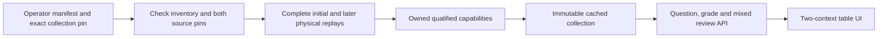

# Two-context physical flop practice collection

The collection combines the two independently qualified BB77 decisions from the same supplied hand model. Question 0 starts the flop with a 6.5 bb pot and check/bet menu. Question 1 starts after BB checks and BTN bets 3.25 bb, with a 9.75 bb pot and fold/call menu. Each retains its original question, grading, model and unit identities. This is a research practice collection with two active players at a six-seat table, supplied hand beliefs, no rake and one flop bet followed by exact checkdown. It is not a coherent full-hand policy or wider range coverage.

## Ownership and identity

`SixMaxFlopIntervalCollection` requires both owned qualification `Result` objects. Constructing each cached trainer requires its private qualified capability; public reports, questions, manifest booleans and matching hashes cannot grant grading authority. Both sources must share the connected game, hero cards, physical board and public preflop handoff. Ordered typed question and feedback unions preserve `INITIAL_CHECK_BET` and `BB_FACING_BET`; exactly one original protocol object is present in each union, with the other explicitly null.

The collection pin is SHA-256 over a canonical string-only identity containing the collection schema, ordered selection and the two typed source report pins. Its value is `fb77bda6bf843e8a2e4ec49c91070e608b240e50e770674601413351ad099436`. It binds source order and versions, but calculating that identity still grants no authority. Source pins are the unchanged initial `49b1be1e91bb0ae7cae6a3171f4e15e516fc0a52be80efabc6d281e8ec5863d8` and later `4526ff928e05bc0e962d78661a19b82cb127d5e058f7a25bb8fd1e393c51f7ea` report hashes.

`SixMaxFlopIntervalCollectionLoader` accepts only an operator-configured manifest and exact collection pin. The bounded 64 KiB manifest lists two ordered typed sources with sibling filenames and exact report pins. All inventory, distinct-file, request and source-pin checks precede either expensive replay. Both complete owned physical replays run once at startup, then the resulting capabilities construct the cached collection. Resolved file identities, sizes, modification times and stored-byte hashes are compared before and after the entire operation, including the manifest. A rehashed edited report and manifest cannot bypass physical replay. No solver algorithm, certificate tolerance or resource cap is changed.



## Session and replay

Question indices 0 and 1 are explicit, deterministic selections. A grade requires exact cached question equality and a legal action for that question. The HTTP request carries both the collection pin and the selected source report pin. A check cannot be graded as a later fold/call action, and the two source pins cannot be swapped.

Reviews reconstruct zero to 100 explicit choices, preserving every attempt index, question index, action and complete typed feedback. Replay compares the complete question inventory, source order, grades and counts. `distinctQuestionsAttempted` counts contexts once even after repeated attempts. Other counts classify explicit attempts against each question's educational loss limit; they are not general poker accuracy, cumulative EV loss or curriculum coverage. Artifacts have stored and expanded 1 MiB limits, plain/gzip support and exclusive creation.

The [manifest](data/supplied-two-flop-interval-collection-manifest.json) and [saved review](data/supplied-two-flop-interval-collection-review.json) record `0:check`, `1:fold`, `0:bet`, `1:call`: two contexts attempted, two within-limit and two outside-limit attempts. The original single-question requests, reports, receipts and drills retain their exact bytes.

```text
com.pokerlab.solver.SixMaxFlopIntervalCollectionMain create <manifest> <collection-pin> <new-review.json[.gz]> 0:check 1:fold 0:bet 1:call
com.pokerlab.solver.SixMaxFlopIntervalCollectionMain replay <manifest> <collection-pin> <review.json[.gz]>
```

## Independent evidence

The [stdlib checker](../scripts/check-flop-interval-collection.py) supports this fixed saved collection. It runs the unchanged source checkers, verifies their original physical/tree evidence and 35 endpoint certificates, and checks three policies at each of the two decision contexts. Six context-policy checks do not mean six distinct strategies. It runs no optimizer. The string-only collection identity is independently reproducible without the floating-point serialization caveat of report hashes.

The [receipt](data/supplied-two-flop-interval-collection-independent-check.json) binds the manifest/review/checker bytes and both complete source receipts. The checker compares typed question inventory and every mixed grade, then recomputes repeated-attempt counts. Thirty review corruption controls and four manifest corruption controls target source order, types, null branches, pins, hidden information, context, indices, action menus, ranges, verdicts and counts. Separate controls cover empty and 100-attempt reviews, stored/expanded bounds and duplicate JSON keys.

```sh
python scripts/check-flop-interval-collection.py docs/data/supplied-two-flop-interval-collection-manifest.json docs/data/supplied-two-flop-interval-collection-review.json --output <new-receipt.json>
python -m unittest discover -s scripts -p 'test_check_flop_interval_collection.py'
```

## Cached opt-in API

`/api/v1/trainer/research/flop-interval-collection` is absent by default. Enabling `pokerlab.trainer.flop-interval-collection-enabled` requires the manifest path and exact collection hash. Startup completes both physical replays before readiness. Requests never select files, accept caller payoffs or launch solver work.

| Route | Behavior |
| --- | --- |
| `GET /api/v1/trainer/research/flop-interval-collection` | Collection pin, ordered kinds, research status, common model/chance/belief provenance, units and limits |
| `GET .../questions/{index}?collectionHash=...` | One cached typed question; index is 0 or 1 |
| `POST .../grade` | `{ "collectionHash": "...", "questionIndex": 0, "reportHash": "...", "action": "check" }` |
| `POST .../review` | `{ "collectionHash": "...", "choices": [{ "questionIndex": 1, "reportHash": "...", "action": "fold" }] }` |

Successful responses use `Cache-Control: no-store`. Unknown fields, stale/cross-question pins, illegal menus, invalid indices and malformed or oversized reviews fail validation. Public objects contain no opponent hole cards, private worlds, reference policies or LP witnesses. Metadata retains `UNAVAILABLE_NO_SOURCE_POLICY` and `trainerAdmission=false`.

The [Compose overlay](../docker-compose.trainer-flop-interval-collection.yml) mounts the manifest and four source files read-only. CI checks default absence, real pinned startup, both question protocols, all four grades, complete mixed review, honest retry counts and invalid requests. Readiness tests retry transport startup failures while incorrect successful metadata fails immediately.

```sh
docker compose -f docker-compose.yml -f docker-compose.trainer-flop-interval-collection.yml up --build -d
python scripts/smoke-flop-interval-collection.py
```

## Table UI and validation

`#interval-flop-collection` preloads and validates both public questions before enabling practice. Previous/next controls select contexts without losing the session. Each table shows its actual board, chips and betting history; each retains its own graded ranges when revisited or retried. Both actions' EV/loss ranges, current feedback, navigation and review controls stay below hero. Deep links contain the collection pin and explicit question index; stale pins, unsupported/duplicate parameters and contradictory sources block practice. The original two single-question parsers remain strict and are reused inside the typed envelope.

The UI validates the pair's shared cards/board/preflop handoff and consistent bet size, typed menus and per-question feedback. It guards duplicate clicks/keyboard shortcuts, cancelled requests, changed ranges and edited reviews. Disabled servers show no fixture fallback. Empty and capped sessions can still be reviewed and exported. The frontend fixture is required to be byte-identical to the physically replayed saved review, independently of component tests.

Local validation passes 15 new Java tests with real pinned startup and rehashed-tamper rejection; five Python checker tests plus 19 readiness tests; and all 367 frontend tests, lint, type checking and production build. Live browser checks against the actual Java loader play all four moves across both contexts and compare the downloaded review to the entire saved artifact. At 1366×768, players, action ranges, navigation and feedback fit together. Phone layouts are checked for horizontal overflow; longer feedback/reviews can scroll vertically.

Next improve solver/content coverage through separately declared reference-budget and model studies. Broader ranges, rake, rich turn/river betting and truly multiplayer equilibrium remain separate work. These two related contexts do not add new range coverage or establish a full-hand strategy. AWS deployment remains paused.
