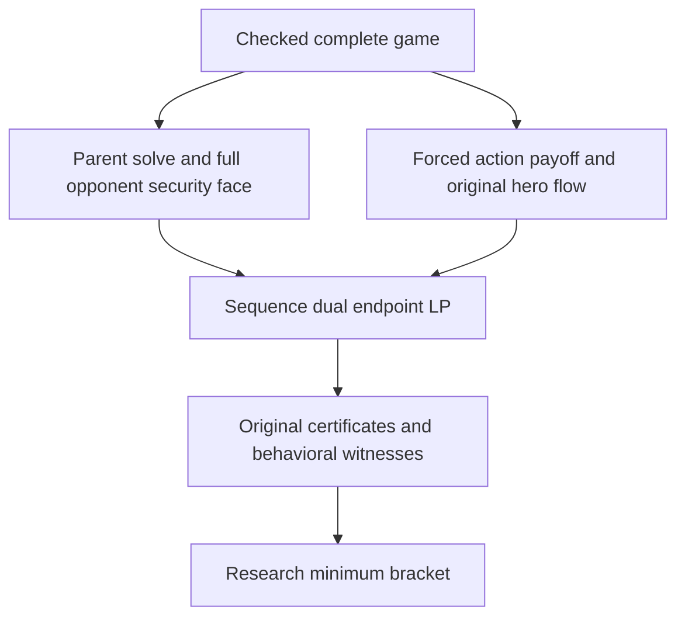

# Root minimum without continuation plan enumeration

## Scope declared before implementation

Build a separate research kernel for a root action's minimum optimal continuation
value over the complete original opponent security face. Replace pure continuation
enumeration with the dual of the hero's original sequence-form flow constraints.
Preserve the existing reduced-plan kernel, reports, algorithms and published
trainer bounds, including the unresolved raise and retained work-limit failure.
The new kernel grants no trainer admission or grading capability.

Keep the original 20,000-node, depth-32, 64-information-set and 129-sequence bounds
per actor, 512 LP rows/columns, eight-million compiler units, 10,000 endpoint
pivots, four-billion endpoint arithmetic units, 1e-8 numerical/security tolerance
and 0.0001 original chance-reach floor. Parent solves keep their existing separate
budgets. No fallback, alternative LP representation or cap increase follows a
numerical failure. A question must occur before every player action and its
continuation must not share hero information with outside root observations.

Permit analytic finite games only. Compare both actor orientations, constant-sum
offsets, dominated actions, shared hidden information, forced/terminal actions,
non-unit original reach, dependent own choices and distinct opponent branches.
Include a 32-private-type control with 2^32 complete continuation maps, while
retaining at most 129 own sequences. Test the existing plan-limited kernel's
rejection separately; do not increase its 64-plan ceiling.

Retain eight fixed analytic captures in a separate test-resource file: the five
unchanged small root-minimax controls, the 32-type control for each hero
orientation, and a quarter-reach control. Java must exactly replay every saved
audit. An independent Python checker reconstructs original flow projections,
global and conditional payoff matrices, the forced-action constraints and full
endpoint LP. Check all parent and endpoint certificates with exact binary64
rational arithmetic. Use exhaustive pure continuations only for small controls;
the large control has a separate closed-form value and a fixed uniform opponent.
The checker performs no LP optimization, CFR training or poker evaluation.

New local validation and capture runs are analytic only. New CI tests retain all
existing physical replay classes and checks, with an additive independent-check
command. No physical poker source generation, native API startup, parameter search,
source replacement, API, UI or AWS deployment is included. Preserve all 392
existing data files, current source pins, old previews and the interview guide.
The next physical evaluation needs a separate scope and measured result.

## Formulation



Use the complete original hero and opponent realizations, with integer affine
projections `x = x0 + T z` and `y = y0 + U w`. Compile the selected action's
conditional terminal payoff from its original chance-only root posterior. Other
root observations contribute zero to this payoff, while their original flows and
the full global security face remain present.

The selected action's original own-sequence mass must equal one. Append both
inequalities for `T[action] z = 1 - x0[action]` to the original hero constraints,
giving `P_a z <= p_a`. The conditional objective is
`c + a.z + b.w + z' D w`. Dualizing the hero's constrained best response gives:

```text
minimize c + b.w + p_a.lambda
subject to the complete original global opponent security face
           D w - P_a' lambda <= -a
           w >= 0, lambda >= 0
```

The owned LP maximizes the negative objective. Its original primal/dual
certificate brackets the minimum. The upper bracket bounds that minimum only,
not every opponent strategy's action value. Check the reconstructed opponent's
complete original flow and behavioral security. Reconstruct a forced-action hero
flow from the endpoint dual and check that its conditional profile value equals
the independently computed information-set best response. Preserve the full
original LP matrix, projections, parent witnesses, reach support and work counts.
These are numerical brackets under the unchanged binary64 certificate tolerance,
not symbolic bounds on an exact Nash set.

## Review status

The project owner cleared code revision `dddc4c2` for PR creation on 2026-11-04
with “cleared dddc4c2”. This factual approval is recorded across project
documentation and the central review history. Later material code changes require
renewed review. PR creation and full CI follow this clearance.

## Analytic results and reproduction

All eight saved controls reproduced their expected minima. The new implementation
agrees with the original five reduced-plan results, including the -8/3 nested
continuation control. Both 32-private-type controls have minimum zero at one
shared half-and-half opponent mixture. Their 2^32 complete continuation maps are
represented by 67 original hero sequences; no continuation map is enumerated by
the new endpoint calculation. The old kernel still rejects them at its original
64-plan limit.

Each large endpoint used 69 variables, 68 inequalities, 98 pivots, 97,118,025
charged LP arithmetic units and 32,112 compiler units. These are measurements for
the saved analytic controls, not a prediction of physical-poker runtime. The
independent checker reconstructs the original matrices and validates 16 parent
and eight endpoint certificates with exact rational arithmetic. It uses a
literal information-set best response and the large control's closed form,
without solving another LP or enumerating billions of strategies.

The frozen test resource stores 19,775 compressed / 240,438 expanded bytes and is
pinned by SHA-256 `7fde2e928d0a05330b6466264fd057b7d1ffae4f5411eb291046eae019efe51c`.
Complete Java audit replay checks its support, projections, witnesses, identities
and charged work. The independent checker reuses the unchanged numeric helpers
with their own byte pins, and separately rebuilds the new forced-action domain
and LP. Its corruption tests reject altered games, hidden information, gates,
face/conditional coefficients, missing forced-action constraints, primal/dual
points, original flows, response values, brackets, work and scope claims.

Local validation passed 94 Java tests, including 19 new kernel tests and the
existing LP, affine-flow, original sequence-form, root, conditional and reduced-
continuation controls. Twelve Python methods cover the independent checker.
Java also checks terminal/forced moves, both signs of utility offsets, immutable
input capture, rejection of parsed JSON as an owned result, imperfect recall, three actors,
original sequence ceilings and zero compiler/pivot/arithmetic budgets.
Two hidden root worlds with shared hero information return 1 rather than the
incorrect deal-revealing value of 3, while preserving their original 0.25 reach
and one-time posterior normalization.

```text
mvn -pl solver -am "-Dtest=RootSequenceMinimaxTest,RootMinimaxTest,FiniteTwoPlayerRootActionIntervalsTest,FiniteTwoPlayerConditionalActionIntervalsTest,ReducedHeroContinuationsTest,FiniteTwoPlayerAffineSequenceFormTest,FiniteTwoPlayerSequenceFormTest,BoundedLinearProgramTest" "-Dsurefire.failIfNoSpecifiedTests=false" test
python scripts/check-root-sequence-minimax.py
python -m unittest discover -s scripts -p test_check_root_sequence_minimax.py
```

The optional analytic capture entry point is the test-class `main`; it requires
one unused output path and refuses an existing file before solving. Published
fixtures are never regenerated by tests. The CI solver-3 step adds the independent
checker alongside every existing command; Java's existing test-inventory mechanism
automatically includes the new test class. Full PR CI follows user clearance.

This completes an analytic solver-capacity milestone. A physical root study,
fresh-reference comparison and any trainer adoption still require separate
declarations and evidence. No current trainer EV or classification changed.

<!-- pokerlab-user-code-review:start -->
Code review confirmed: the project owner reviewed code changes at
`dddc4c2a5cdd4adcb0854b8d78a69f350fcf6bc4` and cleared PR creation on
2026-11-04 (Europe/London), with “cleared dddc4c2”. This confirmation applies to
that code revision. See the project’s Code Review History for the approval record.
<!-- pokerlab-user-code-review:end -->
