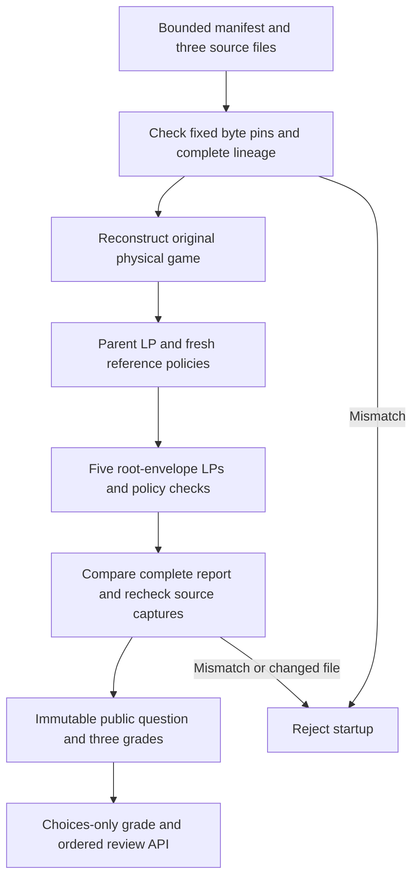

# Pocket-sevens cached preflop API

This source adds a second private hand to the existing preflop trainer backend:
BB `7d 7h` facing the supplied BTN opening range. There are six seats, two active
players, one decision and three actions. The source uses the existing selected-flop
size-menu continuation game. It is research evidence within that supplied model;
it does not solve unrestricted six-player cash poker. The raise result remains
strategy-dependent and must not be labelled an error or a certified good action.

The project owner cleared code revision `bc35089a63f16b4f6afb0aa4ef34323c7b282abd`
on 2026-11-07 (Europe/London), with “cleared bc35089”. This confirmation applies
only to that revision. Code Review History preserves this and earlier approvals.

## Ownership and startup

`SixMaxSevensPreflopDrillLoader` captures a bounded manifest and its three files:
the canonical LF request, saved sevens report and original flop-size-menu parent.
All file names stay in the manifest directory. Stored SHA-256 pins and the typed
report hash are fixed in the loader. Duplicate fields, unknown fields, scalar
coercions, aliases, symlinks and oversized files fail before numerical work.

The loader passes the original pinned parent to the existing sevens study API.
That API captures the parent independently, reconstructs physical payoffs, solves
the original parent, generates its fresh reference policies and solves the five
root-envelope LPs. The complete result must equal the captured saved report.
The loader then rechecks the manifest and every dependency's identity, metadata
and bytes before exposing its immutable cache. Changing a report and refreshing
a manifest checksum cannot create an accepted study.

One startup reserves one physical game, up to two parent calls/four parent LPs,
five envelope LPs and two fresh references totalling 240,000 CFR iterations. All
existing solver work caps and numerical tolerances remain unchanged. The cache
accepts only an opaque owned `SixMaxSevensRootStudy.Result`, with the exact
published identity and complete supported feedback. A deserialized report or
public snapshot cannot confer this capability.

## Public question and EV meaning

The question contains the six public seats, prior actions, acting BB, pot 4.5 BB,
2 BB to call, hero sevens and an empty preflop board. Opponent private cards,
future board cards, solver policies, information-set identities and certificates
are absent from the public projection.

The source report records absolute terminal profit. The trainer adds the hero's
already posted 1 BB exactly once to both EV endpoints, so the EV scope is current
decision profit. Loss endpoints and classifications remain unchanged. Fold has
approximately zero future EV, call has approximately 1.6855 BB EV, and raise has
a wide interval; the latter remains unresolved. These are conservative bounds,
not attained endpoints or frequencies from a unique equilibrium strategy.

## API

The separate prefix is `/api/v1/trainer/research/root-sevens-preflop-drill`.

| Method | Path | Purpose |
| --- | --- | --- |
| GET | `/` | Metadata, exact study pin and startup budget |
| GET | `/questions/0?studyHash=...` | The owned public question |
| POST | `/grade` | One cached legal grade |
| POST | `/review` | Recompute an ordered review from choices |
| POST | `/review/export` | Deterministic UTF-8 JSON download with LF endings |

A grade body contains only `studyHash`, `sourceCaseIndex: 0` and `action`.
A review contains the study pin and at most 128 choices, each with that index and
one action: `fold`, `call` or `raise:9.0`. Request bodies have a 32 KiB cap.
Unknown, duplicate, missing, null, coerced or fractional fields fail. Client EVs,
classifications, counts and saved reviews cannot override cached grades. All
successful routes use `Cache-Control: no-store`.

Reviews preserve order, repeats and ordinals. Counts distinguish within-limit,
outside-limit and strategy-dependent attempts. Empty reviews have zero distinct
questions; repeated attempts still represent one distinct question. All routes
continue using the same objects if startup files subsequently become unavailable.
No HTTP request constructs a game, reads source files or runs an optimizer.

## Local enablement

The default application exposes none of these routes and creates no sevens cache.
Opt in using `TRAINER_ROOT_SEVENS_PREFLOP_ENABLED=true`, the manifest path in
`TRAINER_ROOT_SEVENS_PREFLOP_MANIFEST_PATH` and the exact typed study hash in
`TRAINER_ROOT_SEVENS_PREFLOP_STUDY_HASH`. The study hash is
`5f52b053c7610adbfb4abd2cfb210674b4a325d8b870cd350edc22d192708da6`.

The separate `docker-compose.trainer-root-sevens-preflop.yml` overlay mounts only
the four required files read-only. A dedicated CI job checks absence without opt-in,
then a real owned container startup, OpenAPI, all three grades, strict input
controls, ordered/repeated/maximum reviews and canonical downloads.

## Evidence and limits

The public fixture and review are captured from the native HTTP service. A
standard-library Python checker independently validates the original physical
study and certificates, reconstructs this public projection, applies the one-time
commitment shift and checks the canonical export bytes. Corruption tests reject
hidden cards, future boards, wrong EV scope, altered losses, replaced source pins,
boolean or floating protocol integers, invented admission and lost raise ambiguity.

Local validation reserves exactly three owned replays: one native HTTP startup,
one shared cache test setup and one cached Spring test context. No new numerical
source report is generated. Full production-container CI is required before the
next PR can be merged. The [sevens table trainer](sevens-preflop-table-trainer.md)
connects this backend at `#root-sevens-preflop`; that new frontend revision is
cleared at `028914b`. AWS deployment remains paused.

## Validation for owner review

Local checks passed: 27 Java tests (8 cache, 10 loader guards, 6 enabled API and
3 disabled API), 12 independent projection/corruption tests and 5 HTTP-smoke unit
tests. The native service passed real HTTP/OpenAPI validation. Formatting checks
and packaging of all five modules passed. All 416 previous data files were
preserved, with four new public evidence artifacts. The proposed test inventory
has 373 classes and retains all 369 earlier class assignments. The CI workflow
retains all 28 existing jobs and adds the sevens container job, for 29 total.

Docker is unavailable locally; the new production-container check and complete
regression CI remain pending a reviewed PR. No new library issue was identified
in these checks. Existing solver implementations and dependency versions are
unchanged. No claim of full six-player equilibrium or production deployment is
made by these results.

<!-- pokerlab-user-code-review:start -->
Code review confirmed: the project owner reviewed code changes at
`838fd5ac57e6524998181efedf99a6a1d6d7f20d` and cleared PR creation on
2026-11-08 (Europe/London), with “cleared 838fd5a”. This confirmation applies to
that code revision. See the project's Code Review History for the approval record.
<!-- pokerlab-user-code-review:end -->
